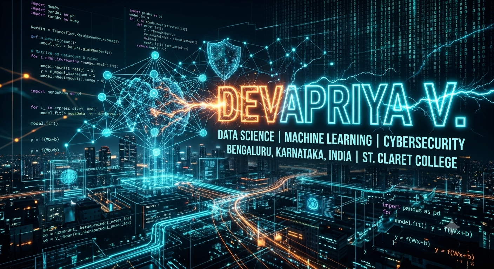

<div align="center">

  <!-- Scaled & Centered Professional Tech Header -->
  

  <br><br>

  <!-- Dynamic Typing Animation -->
  <h1></h1>

  <p><b>Undergraduate Computer Applications Student @ St. Claret College, Bengaluru</b></p>
  <p><i>Transforming complex data pipelines into actionable, intelligent insights.</i></p>

  <!-- Interactive Badges -->
  <p>
    
    
  </p>

</div>

---

### ⚡ Operational Status

```yaml
Operational_Focus: Engineered data pipelines and deep predictive models.
Core_Interests: Machine Learning, Deep Learning, Statistical Modeling, and Dashboards.
Motto: "Turning raw data into impactful intelligent applications."
